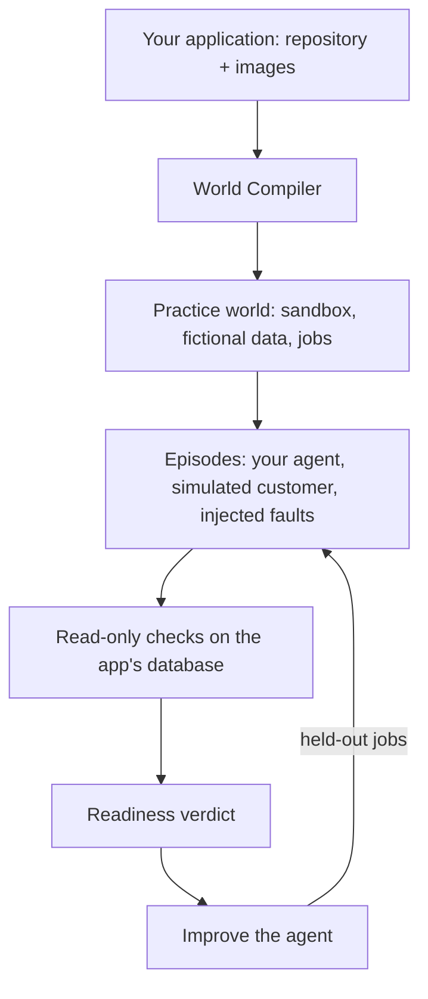

<div align="center">

<a href="https://rehearsalkit.xyz">
  
</a>

# Rehearsal

**Prove your AI agent works before it ships.**

Rehearsal runs your agent on a working copy of your real application, with fictional data, and decides every outcome by reading the application's own database. No model grades the result.

[](https://pypi.org/project/rehearsal-kit/)
[](https://pypi.org/project/rehearsal-kit/)
[](https://github.com/MitudruDutta/rehearsal/actions/workflows/tests.yml)
[](https://docs.rehearsalkit.xyz)
[](LICENSE)

[Website](https://rehearsalkit.xyz) · [Documentation](https://docs.rehearsalkit.xyz) · [Quickstart](#quickstart) · [Self-hosting](#self-hosting) · [Planning docs](#planning-docs) · [Report a bug](https://github.com/MitudruDutta/rehearsal/issues)


</div>

## Why Rehearsal

An AI agent can tell you it finished the job while the records say otherwise. Most evaluations ask another model whether the transcript looks right, and a confident agent can talk its way to a pass.

Rehearsal tests the agent where it will actually work: on your application, through the same tools, with a customer who changes their mind and requests that fail on purpose. Pass or fail comes from read-only checks against the application's database, so "refund issued" only counts if the refund is there, exactly once.

## Features

- **World Compiler.** Point it at a repository and its published container images. It reads the source, starts the application in an isolated sandbox, seeds fictional data, chooses the tools each role may use, and writes jobs it proves can be passed and failed.
- **Database-verified outcomes.** Every episode ends with read-only checks on the application's own records: goal reached, no duplicate side effects, claims that match the data.
- **Simulated customers.** Customers revise their request mid-task, so an agent that finishes the old request gets caught.
- **Failures on purpose.** Requests time out after the change already went through, so blind retries show up as duplicates.
- **Readiness verdict.** Ready to pilot, or not yet, with every measure linked to the episodes behind it.
- **Improve, then compare.** The improvement agent proposes the next agent version from failed training jobs. Compare both versions on held-out jobs neither has seen.
- **Bring your own agent.** Describe an agent with instructions and a model, or drive episodes from your own code in any language through the episode API.
- **Every step traced.** Builds, rehearsals and improvements are traced with [Neatlogs](https://neatlogs.com), down to each model call, tool call and check.
- **Any model provider.** OpenAI, Anthropic, Google, Mistral, xAI, DeepSeek, Groq, Together, Fireworks, Cerebras, Nebius, NVIDIA, OpenRouter, a LiteLLM proxy, or any OpenAI-compatible endpoint, with fallback chains and spend caps.

## How it works



1. **Build a practice world.** The World Compiler turns an application into a versioned, resettable world. Each episode starts from the same snapshot.
2. **Rehearse the agent.** Your agent works through jobs while a simulated customer talks to it and faults are injected.
3. **Verify and improve.** Checks decide each outcome. Failures feed the next agent version, which is compared on jobs it has never seen.

## Quickstart

Install the client (the `rehearsal` CLI and the Python SDK). It runs on any OS with Python 3.11 or newer.

```bash
pip install rehearsal-kit
rehearsal login            # opens the console in your browser; approve the code shown
```

Build a world and evaluate an agent on the hosted service at [rehearsalkit.xyz](https://rehearsalkit.xyz):

```bash
rehearsal apps import-catalog                            # pinned open-source apps: Gitea, Chatwoot, Vikunja, WordPress, ...
rehearsal apps list                                      # note an application id
rehearsal build APP_ID --watch                           # compile a practice world (spends model budget)
rehearsal worlds list                                    # note the published world version id
rehearsal profiles create support-agent                  # add --prompt-file FILE for your own instructions
rehearsal eval WV_ID --profile PROFILE_ID --split dev --watch
rehearsal runs episode EPISODE_ID                        # actions, messages, and which checks failed
rehearsal improve PROFILE_ID RUN_ID                      # propose the next agent version
rehearsal eval WV_ID --profile NEW_PROFILE_ID --split holdout --watch
rehearsal compare RUN_A RUN_B
```

Add your own application by pinning its source commit and images:

```bash
rehearsal apps add my-app --git https://github.com/you/app --commit <full commit sha> \
  --image web=registry.example.com/app@sha256:<digest> --policies-file policies.md
```

<details>
<summary><b>Use it from Python</b></summary>

```python
from rehearsal.sdk import Rehearsal

rh = Rehearsal()  # your sign-in, or REHEARSAL_URL and REHEARSAL_API_KEY in CI
app = rh.applications.create(
    "my-app",
    {"kind": "git", "url": "https://github.com/you/app", "commit": "<sha>"},
    images={"web": "registry.example.com/app@sha256:<digest>"},
)
build = rh.worlds.build(app["id"])
rh.jobs.wait(build["job_id"])
```

To drive episodes with your own agent, read `rh.external.observation(episode_id)` and send tool calls with `rh.external.act(...)`. See [examples/agents/langgraph_react.py](examples/agents/langgraph_react.py) and [PACKAGE.md](PACKAGE.md).

</details>

<details>
<summary><b>Use it from your AI assistant</b></summary>

Install the plugin for Claude Code (Codex works the same way with `codex plugin ...`):

```bash
claude plugin marketplace add MitudruDutta/rehearsal
claude plugin install rehearsal@rehearsal
```

Or add only the MCP server:

```bash
claude mcp add rehearsal -- uvx --from "rehearsal-kit[mcp]" rehearsal mcp
```

Then ask your assistant to build a world, run an evaluation, or explain a failed episode.

</details>

## Self-hosting

The server, workers and sandboxes run on Linux with Docker. The CLI and SDK run anywhere.

**Requirements:** Python 3.11–3.13, Docker with Compose, PostgreSQL (local or managed, Supabase recommended), and a key for at least one model provider. Node 22 and pnpm 10 are needed only to build the console from source.

### Docker Compose

`infra/compose.full.yaml` runs the complete stack: migrations, the API with the console, workers, and optional HTTPS through Caddy.

```bash
cp infra/deploy.env.example infra/deploy.env      # database URL, session secret, model keys
docker compose -f infra/compose.full.yaml --env-file infra/deploy.env up -d
docker compose -f infra/compose.full.yaml --env-file infra/deploy.env exec api rehearsal bootstrap
docker compose -f infra/compose.full.yaml --env-file infra/deploy.env up -d --scale worker=6
```

Add `--profile public` with `REHEARSAL_DOMAIN` set to serve HTTPS. The worker controls the host's Docker socket and runs application source, so use a dedicated machine. For arbitrary third-party repositories, use per-job VM isolation.

### From source

```bash
python -m venv .venv && source .venv/bin/activate
python -m pip install -e '.[server,telemetry,dev]'
cp .env.example .env                                     # set REHEARSAL_SESSION_SECRET and a provider key
(cd web && pnpm install --frozen-lockfile && pnpm build) # build the console once

rehearsal up                                             # PostgreSQL in Docker on 127.0.0.1:5433, then migrations
rehearsal bootstrap                                      # prints the project id and an admin API key, shown once
export REHEARSAL_URL=http://127.0.0.1:7800 REHEARSAL_API_KEY=rh_...
rehearsal users add you@example.com --project prj_...    # a console login, password of 10+ characters

rehearsal serve                                          # API and console on http://127.0.0.1:7800
rehearsal worker                                         # builds and evaluations, in a second terminal
```

Generate the session secret with `python -c "import secrets; print(secrets.token_hex(32))"`. Keep keys in `.env`, which git ignores.

The [self-hosting guide](https://docs.rehearsalkit.xyz/self-hosting) covers requirements, Docker Compose, upgrades, Windows and troubleshooting.

## Configuration

Settings come from the environment, or from `.env` in the working directory. The main ones:

| Variable | Default | Purpose |
|---|---|---|
| `REHEARSAL_DATABASE_URL` | local PostgreSQL on port 5433 | Control-plane database |
| `REHEARSAL_SESSION_SECRET` | development value | Signs console session cookies; set your own |
| `REHEARSAL_MODEL_COMPILER`, `_AGENT`, `_PARTICIPANT`, `_IMPROVER` | Groq, OpenAI, Anthropic, Google, then OpenRouter | Model chains, `provider:model[,provider:model...]` |
| `OPENAI_API_KEY`, `ANTHROPIC_API_KEY`, ... | none | One key for each provider the chains name |
| `NEATLOGS_API_KEY` | none | Turns on tracing; everything runs without it |
| `REHEARSAL_SIGNUP` | `open` | `closed` stops new workspaces from the sign-in page |
| `REHEARSAL_MONTHLY_ALLOWANCE_USD` | `0` (no limit) | Model spend a workspace may use per month |
| `REHEARSAL_URL`, `REHEARSAL_API_KEY` | `https://rehearsalkit.xyz`, none | Where the CLI and SDK connect |

Every setting, with its default, is in the [configuration reference](https://docs.rehearsalkit.xyz/reference/configuration). `rehearsal prices` shows the price the server uses for each configured model.

## Development

```bash
# Unit tests, no services needed
python -m pytest tests/unit -q

# Integration tests: need `rehearsal up` and, for the sandbox test, Docker
python -m pytest tests/integration

# Console: dev server on http://localhost:3000, proxying the API on port 7800
cd web && pnpm dev
cd web && pnpm typecheck
```

`pnpm build` writes the console's static export to `web/out` and copies it to `rehearsal/api/static`, where the API serves it. The documentation site lives in [docs/](docs/).

## Planning docs

Rehearsal was planned before it was built, in three documents that build on each other:

| Document | What it settles |
|---|---|
| [Scope](docs/scope.md) | The problem, who it is for, the decisions from the planning interview, what is in and out of scope, and how success is measured |
| [Product requirements](docs/prd.md) | Users, journeys, numbered functional and non-functional requirements, acceptance criteria, and release status |
| [Technical specification](docs/spec.md) | Architecture, data model, the World Compiler, job validation, sandboxing, scoring, the job queue, interfaces, spending, deployment, and testing |

[CHECKPOINTS.md](CHECKPOINTS.md) records how the build followed them: each key decision with the Entire checkpoint of the session that made it.

## Status

Rehearsal is in early release (0.1.x). World builds, evaluations, improvement and comparison work end to end. `rehearsal train` and `rehearsal run-bundle` exist but report that they are not implemented yet. A world build takes one to three hours and spends model budget; every job has a spend cap.

## Built with

- [Neatlogs](https://neatlogs.com) traces every build and rehearsal (workflow roots for compilation, evaluation and improvement; secrets are masked before export).
- [Entire](https://entire.io) keeps the AI coding sessions behind the commits in this repository, configured in `.entire/settings.json`. [CHECKPOINTS.md](CHECKPOINTS.md) lists the key decisions with their checkpoints, and [entire-rehearsal](https://github.com/MitudruDutta/entire-rehearsal) is an open-source Entire CLI plugin that ties an agent's instruction changes to their Rehearsal results.
- [cfo.ai](https://cfo.ai) modeled the business plan.

## Contributing

Issues and pull requests are welcome. Run the unit tests and the console typecheck before opening a pull request, and keep secrets out of commits: `.env` and `infra/deploy.env` are ignored by git.

## License

MIT. See [LICENSE](LICENSE).
