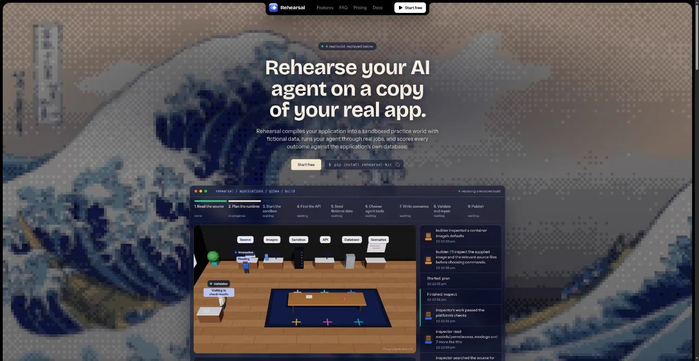
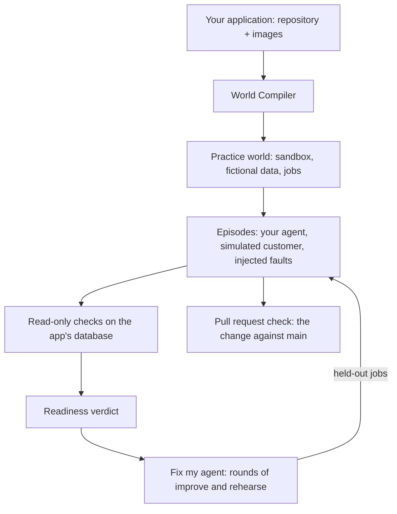

<div align="center">

<a href="https://rehearsalkit.xyz">
  
</a>

# Rehearsal

**Prove your AI agent works before it ships.**

Rehearsal is CI for AI agents. It runs your agent on a working copy of your real application, with fictional data, and decides every outcome by reading the application's own database. No model grades the result. When the agent fails, Rehearsal fixes it in rounds and proves the fix on jobs it has never seen; when someone changes the agent, a pull request check catches regressions.

[](https://pypi.org/project/rehearsal-kit/)
[](https://pypi.org/project/rehearsal-kit/)
[](https://github.com/MitudruDutta/rehearsal/actions/workflows/tests.yml)
[](https://docs.rehearsalkit.xyz)
[](LICENSE)

[Website](https://rehearsalkit.xyz) · [Documentation](https://docs.rehearsalkit.xyz) · [Quickstart](#quickstart) · [Nemotron on Nebius](#nebius-x-nvidia-global-ai-hackathon) · [Self-hosting](#self-hosting) · [Planning docs](#planning-docs) · [Report a bug](https://github.com/MitudruDutta/rehearsal/issues)



</div>

## Why Rehearsal

An AI agent can tell you it finished the job while the records say otherwise. Most evaluations ask another model whether the transcript looks right, and a confident agent can talk its way to a pass.

Rehearsal tests the agent where it will actually work: on your application, through the same tools, with a customer who changes their mind and requests that fail on purpose. Pass or fail comes from read-only checks against the application's database, so "refund issued" only counts if the refund is there, exactly once.

## Features

- **World Compiler.** Point it at a repository and its published container images. It reads the source, starts the application in an isolated sandbox, seeds fictional data, chooses the tools each role may use, and writes jobs it proves can be passed and failed.
- **Database-verified outcomes.** Every episode ends with read-only checks on the application's own records: goal reached, no duplicate side effects, claims that match the data.
- **Simulated customers.** Customers revise their request mid-task, so an agent that finishes the old request gets caught.
- **Failures on purpose.** Requests time out after the change already went through, so blind retries show up as duplicates.
- **Readiness verdict.** Ready to pilot, or not yet, with every measure linked to the episodes behind it.
- **Fix my agent.** A loop that writes the next agent version from failed training jobs, rehearses it, and keeps it only if it verifies more episodes without breaking a rule. Rejected ideas are shown to the next round. The best version is then proved against the original on held-out jobs that no round has seen.
- **Pull request checks.** `rehearsal gate` and a GitHub Action rehearse a changed agent next to the version on `main` and fail the check on a broken rule or any regression.
- **Bring your own agent.** Describe an agent with instructions and a model, or drive episodes from your own code in any language through the episode API.
- **Every step on the record.** Each build, rehearsal and improvement keeps its full timeline in Rehearsal: model calls, tool calls, checks, and what each one cost, broken down by role and model.
- **NVIDIA Nemotron by default, any provider if you want.** Every role runs on Nemotron through Nebius Token Factory, routed by role, with reasoning switched on only where it pays. OpenAI, Anthropic, Google, Mistral, xAI, DeepSeek, Groq, Together, Fireworks, Cerebras, OpenRouter, a LiteLLM proxy, or any OpenAI-compatible endpoint also work, with fallback chains and spend caps.

## How it works



1. **Build a practice world.** The World Compiler turns an application into a versioned, resettable world. Each episode starts from the same snapshot.
2. **Rehearse the agent.** Your agent works through jobs while a simulated customer talks to it and faults are injected.
3. **Verify and fix.** Checks decide each outcome. The fix loop turns failures into better versions and keeps only the ones that verify more; the best one is proved on jobs it has never seen.
4. **Guard every change.** A pull request that touches the agent is rehearsed next to `main` before it merges.

## Nebius x NVIDIA Global AI Hackathon

Rehearsal is entered in the Coding and Agentic Engineering track. It existed before the hackathon; what changed during the submission period is listed below.

### How Rehearsal uses NVIDIA Nemotron and Nebius Token Factory

Every model call in Rehearsal goes to an NVIDIA Nemotron open model served by [Nebius Token Factory](https://nebius.com/token-factory), through its OpenAI-compatible API (`https://api.tokenfactory.nebius.com/v1`, `NEBIUS_API_KEY`). There are many roles, and they need different things, so each role has its own model chain:

| Role | What it does | Default chain | Reasoning |
|---|---|---|---|
| World Compiler (most roles) | Reads the source, runs the app in a sandbox, seeds data, writes tools and checks | Nemotron 3 Super, then Ultra | on |
| Hard compiler roles | Designs jobs, investigates failed validations, repairs builds, audits jobs live | Nemotron 3 Ultra, then Super | on |
| Agent under test | Does the job through the application's tools | Nemotron 3 Super, then Ultra | on |
| Simulated customer | Talks to the agent, changes its mind mid-task | Nemotron 3 Nano, then Super | off |
| Improvement step (fix loop) | Writes the next agent version from failures | Nemotron 3 Ultra, then Super | on |

- **Routed by role.** A chain is `provider:model[#think|#nothink]`, so `nebius:nvidia/NVIDIA-Nemotron-3-Nano-30B-A3B#nothink` is Nano with reasoning off. The flag becomes `chat_template_kwargs.enable_thinking` on the request. The next model in a chain takes over when one fails.
- **Reasoning only where it pays.** The simulated customer answers in one or two sentences. With reasoning off, a Nano customer turn went from 2.7 s and 191 output tokens to 0.5 s and 28 tokens in our measurement. Ultra is kept for the roles where a wrong answer costs a whole build: designing jobs and judging them.
- **Measured per role.** Every call records its role, model, tokens, time and cost. The console shows a "Models by role" table for each build, run and fix loop, and `rehearsal prices` shows the price used for each configured model.
- **Tool calls on every size.** Tool calling works on Nemotron 3 Nano, Super and Ultra; the agent under test and the compiler roles depend on it.

### What changed during the submission period

- **Nemotron on Nebius Token Factory became the default for every role.** Before, production ran on models behind a LiteLLM proxy and every World Compiler role shared one chain. Now each role has its own Nemotron chain with a reasoning switch, the hardest compiler roles run on Ultra, and usage is recorded per role.
- **Fix my agent.** Before, the improvement step proposed one new version and left the checking to you. Now an `autofix` job runs rounds of propose, rehearse on train and dev, and keep only if better (more verified, no new rule violation or false completion), feeds rejected ideas to the next round, and proves the best version against the original on held-out jobs. It resumes from its checkpoint after a worker restart. API `POST /v1/autofix`, CLI `rehearsal autofix`, SDK `rh.profiles.autofix`, MCP tool `fix_agent`, and a console page with each round, its reason, its score, and the sentences it changed.
- **Pull request checks.** `rehearsal gate` and a GitHub Action (`action.yml`) rehearse a changed agent next to the version on `main` and fail on a broken rule or a regression, with a Markdown report in the job summary.
- **Models by role** in the console, for builds, runs and fix loops.
- **Cleanup.** Third-party tracing was removed; secret masking now lives in one module. Secret settings no longer appear in printed configuration. Next.js was upgraded to 16.4.2.

### Feedback on Nebius and NVIDIA tools

- **The OpenAI-compatible API made the switch a configuration change.** Rehearsal already spoke the OpenAI chat format, so adding Token Factory was one provider entry: a base URL and a key. Tool calling worked on Nano, Super and Ultra without changes to our tool schemas.
- **The reasoning switch is the most useful knob.** `enable_thinking` per request let us run the same model family in a fast mode for chatty roles and a careful mode for judging roles. It has to go through `extra_body.chat_template_kwargs`, which is easy to miss; a top-level parameter, or a note in the quickstart, would help.
- **Model ids are cased differently** (`nvidia/Nemotron-3-Ultra-550b-a55b`, `nvidia/nemotron-3-super-120b-a12b`, `nvidia/NVIDIA-Nemotron-3-Nano-30B-A3B`). We copy them exactly; a consistent scheme would avoid typos in configuration.
- **Clear per-token prices** let us put a spend cap on every job before it runs, from Nano at $0.06 / $0.24 per million tokens to Ultra at $1 / $3.
- **Serverless AI Jobs did not fit our builds.** A world build starts the application's own containers in a sandbox, so a worker needs Docker. Serverless Jobs run one container, and the documentation does not describe privileged mode or a Docker socket, so our workers stay on a VM with Docker. Rootless or nested container support in Jobs would let each build run as its own job.

## Quickstart

Install the client (the `rehearsal` CLI and the Python SDK). It runs on any OS with Python 3.11 or newer.

```bash
pip install rehearsal-kit
rehearsal login            # opens the console in your browser; approve the code shown
```

Build a world and evaluate an agent on the hosted service at [rehearsalkit.xyz](https://rehearsalkit.xyz):

```bash
rehearsal apps import-catalog                            # pinned open-source apps: Gitea, Chatwoot, Vikunja, WordPress, ...
rehearsal apps list                                      # note an application id
rehearsal build APP_ID --watch                           # compile a practice world (spends model budget)
rehearsal worlds list                                    # note the published world version id
rehearsal profiles create support-agent                  # add --prompt-file FILE for your own instructions
rehearsal eval WV_ID --profile PROFILE_ID --split dev --watch
rehearsal runs episode EPISODE_ID                        # actions, messages, and which checks failed
rehearsal autofix PROFILE_ID RUN_ID --rounds 3 --watch   # fix it in rounds, proved on held-out jobs
rehearsal gate WV_ID --prompt-file agent.md --name support-agent --baseline-file main-agent.md   # the CI check
```

In GitHub Actions, the same check is one step: `uses: MitudruDutta/rehearsal@main`. See [Use Rehearsal in CI](https://docs.rehearsalkit.xyz/guides/use-rehearsal-in-ci).

Add your own application by pinning its source commit and images:

```bash
rehearsal apps add my-app --git https://github.com/you/app --commit <full commit sha> \
  --image web=registry.example.com/app@sha256:<digest> --policies-file policies.md
```

<details>
<summary><b>Use it from Python</b></summary>

```python
from rehearsal.sdk import Rehearsal

rh = Rehearsal()  # your sign-in, or REHEARSAL_URL and REHEARSAL_API_KEY in CI
app = rh.applications.create(
    "my-app",
    {"kind": "git", "url": "https://github.com/you/app", "commit": "<sha>"},
    images={"web": "registry.example.com/app@sha256:<digest>"},
)
build = rh.worlds.build(app["id"])
rh.jobs.wait(build["job_id"])
```

To drive episodes with your own agent, read `rh.external.observation(episode_id)` and send tool calls with `rh.external.act(...)`. See [examples/agents/langgraph_react.py](examples/agents/langgraph_react.py) and [PACKAGE.md](PACKAGE.md).

</details>

<details>
<summary><b>Use it from your AI assistant</b></summary>

Install the plugin for Claude Code (Codex works the same way with `codex plugin ...`):

```bash
claude plugin marketplace add MitudruDutta/rehearsal
claude plugin install rehearsal@rehearsal
```

Or add only the MCP server:

```bash
claude mcp add rehearsal -- uvx --from "rehearsal-kit[mcp]" rehearsal mcp
```

Then ask your assistant to build a world, run an evaluation, or explain a failed episode.

</details>

## Self-hosting

The server, workers and sandboxes run on Linux with Docker. The CLI and SDK run anywhere.

**Requirements:** Python 3.11–3.13, Docker with Compose, PostgreSQL (local or managed, Supabase recommended), and a Nebius Token Factory key (`NEBIUS_API_KEY`) for the default Nemotron models, or a key for any other provider. Node 22 and pnpm 10 are needed only to build the console from source.

### Docker Compose

`infra/compose.full.yaml` runs the complete stack: migrations, the API with the console, workers, and optional HTTPS through Caddy.

```bash
cp infra/deploy.env.example infra/deploy.env      # database URL, session secret, model keys
docker compose -f infra/compose.full.yaml --env-file infra/deploy.env up -d
docker compose -f infra/compose.full.yaml --env-file infra/deploy.env exec api rehearsal bootstrap
docker compose -f infra/compose.full.yaml --env-file infra/deploy.env up -d --scale worker=6
```

Add `--profile public` with `REHEARSAL_DOMAIN` set to serve HTTPS. The worker controls the host's Docker socket and runs application source, so use a dedicated machine. For arbitrary third-party repositories, use per-job VM isolation.

### From source

```bash
python -m venv .venv && source .venv/bin/activate
python -m pip install -e '.[server,dev]'
cp .env.example .env                                     # set REHEARSAL_SESSION_SECRET and NEBIUS_API_KEY
(cd web && pnpm install --frozen-lockfile && pnpm build) # build the console once

rehearsal up                                             # PostgreSQL in Docker on 127.0.0.1:5433, then migrations
rehearsal bootstrap                                      # prints the project id and an admin API key, shown once
export REHEARSAL_URL=http://127.0.0.1:7800 REHEARSAL_API_KEY=rh_...
rehearsal users add you@example.com --project prj_...    # a console login, password of 10+ characters

rehearsal serve                                          # API and console on http://127.0.0.1:7800
rehearsal worker                                         # builds and evaluations, in a second terminal
```

Generate the session secret with `python -c "import secrets; print(secrets.token_hex(32))"`. Keep keys in `.env`, which git ignores.

The [self-hosting guide](https://docs.rehearsalkit.xyz/self-hosting) covers requirements, Docker Compose, upgrades, Windows and troubleshooting.

## Configuration

Settings come from the environment, or from `.env` in the working directory. The main ones:

| Variable | Default | Purpose |
|---|---|---|
| `REHEARSAL_DATABASE_URL` | local PostgreSQL on port 5433 | Control-plane database |
| `REHEARSAL_SESSION_SECRET` | development value | Signs console session cookies; set your own |
| `REHEARSAL_MODEL_COMPILER`, `_REASONER`, `_AGENT`, `_PARTICIPANT`, `_IMPROVER` | NVIDIA Nemotron on Nebius Token Factory, routed by role | Model chains, `provider:model[#think\|#nothink][,...]` |
| `OPENAI_API_KEY`, `ANTHROPIC_API_KEY`, ... | none | One key for each provider the chains name |
| `REHEARSAL_SIGNUP` | `open` | `closed` stops new workspaces from the sign-in page |
| `REHEARSAL_MONTHLY_ALLOWANCE_USD` | `0` (no limit) | Model spend a workspace may use per month |
| `REHEARSAL_URL`, `REHEARSAL_API_KEY` | `https://rehearsalkit.xyz`, none | Where the CLI and SDK connect |

Every setting, with its default, is in the [configuration reference](https://docs.rehearsalkit.xyz/reference/configuration). `rehearsal prices` shows the price the server uses for each configured model.

## Development

```bash
# Unit tests, no services needed
python -m pytest tests/unit -q

# Integration tests: need `rehearsal up` and, for the sandbox test, Docker
python -m pytest tests/integration

# Console: dev server on http://localhost:3000, proxying the API on port 7800
cd web && pnpm dev
cd web && pnpm typecheck
```

`pnpm build` writes the console's static export to `web/out` and copies it to `rehearsal/api/static`, where the API serves it. The documentation site lives in [docs/](docs/).

## Planning docs

Rehearsal was planned before it was built, in three documents that build on each other:

| Document | What it settles |
|---|---|
| [Scope](docs/scope.md) | The problem, who it is for, the decisions from the planning interview, what is in and out of scope, and how success is measured |
| [Product requirements](docs/prd.md) | Users, journeys, numbered functional and non-functional requirements, acceptance criteria, and release status |
| [Technical specification](docs/spec.md) | Architecture, data model, the World Compiler, job validation, sandboxing, scoring, the job queue, interfaces, spending, deployment, and testing |

## Status

Rehearsal is in early release (0.1.x). World builds, evaluations, the fix loop, pull request checks and comparison work end to end. `rehearsal train` and `rehearsal run-bundle` exist but report that they are not implemented yet. A world build takes one to three hours and spends model budget; every job has a spend cap.

## Built with

- [NVIDIA Nemotron](https://www.nvidia.com/en-us/ai-data-science/foundation-models/nemotron/) open models (Nano, Super and Ultra) run every role in Rehearsal.
- [Nebius Token Factory](https://nebius.com/token-factory) serves them.
- FastAPI, SQLAlchemy and PostgreSQL for the control plane; Docker for sandboxes; Next.js for the console and documentation.

## Contributing

Issues and pull requests are welcome. Run the unit tests and the console typecheck before opening a pull request, and keep secrets out of commits: `.env` and `infra/deploy.env` are ignored by git.

## License

MIT. See [LICENSE](LICENSE).
